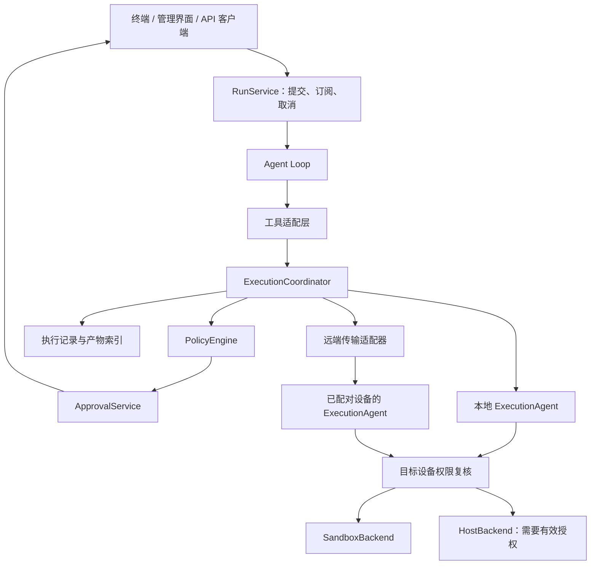

# 执行架构设计

日期：2026-11-12。状态：分阶段实施。已交付范围以 runtime-development.md 和 runtime-validation.md 的最新增量为准；本文完整目标不代表审批、远端设备或全部部署方式已交付。

交付约定：自主实现执行组件，不依赖其他沙盒编排产品或安装编码助手。实现依据公开资料与本项目需求；容器后端复用 Docker 等成熟容器引擎，本机后端复用操作系统隔离机制，不自行研发容器引擎或内核隔离。

执行位置（本机、服务器、已配对设备）与隔离方式（原生进程沙盒、容器）独立建模。本机可以选择容器，服务器也可以部署原生执行端，但服务器宿主机权限始终由管理员策略限制。第一版服务端优先容器，本机原生优先 Windows；不能用位置字段隐式授予权限或切换后端。

## 1. 目标与决策

Velora 支持本地独立运行、服务端独立运行，以及服务端调度连接的本地设备。同一套 Agent Loop 处理模型、上下文、工具批次和任务终态；执行位置的变化不产生第二套 Loop。

分别配置三个维度：

- Runtime 位置：本地或服务端，决定任务状态、模型调用和调度在哪里运行。
- 执行目标：Runtime 所在设备或已配对设备，决定文件、进程和产物属于哪台机器。
- 权限范围：默认沙盒；按明确授权扩大沙盒能力，必要时才允许目标设备上的宿主机执行。

“本地运行”不等于无限制访问电脑，“服务端运行”也不等于允许操作服务器宿主机。模型服务地址与以上维度独立；本地 Runtime 可以调用远端模型。

第一版采用模块解耦、同仓库交付。本地执行组件可由 Runtime 启动为辅助进程，不要求部署独立 HTTP 服务。只有连接其他设备时才引入远端传输。

本地默认采用系统级进程沙盒，在获准的真实工作目录中读写。沙盒不强制复制项目，也不要求所有编辑都在结束时统一应用。容器、独立工作树和隔离副本属于可选工作区方案；修改撤销由独立文件检查点服务提供。

## 2. 逻辑结构



这是逻辑职责图，不要求每个框都是一个服务。ExecutionAgent 是执行端，不调用模型、不做任务规划、不运行另一个 Agent Loop。

### Agent Loop 与工具适配层

Loop 只认识工具调用、等待、结果和终态，不拼接沙盒命令，不处理设备连接。工具适配层把 run_shell、run_python、read_file、write_file、list_dir 转换为执行请求，维持现有模型侧工具名称。

所有模型可触发的本机文件访问和进程启动都必须进入执行层；只改 shell 会留下 Python 和文件工具绕过。xWiki、记忆和 MCP 等其他工具保留各自协议，但副作用和访问权限须由相应工具策略管理，不能把命令沙盒宣传成覆盖全部外部工具。

### ExecutionCoordinator

负责分配稳定 execution_id、解析目标和工作区、检查能力、请求策略决策、持久化意图、提交执行、收集状态。它不以字符串黑名单作为隔离边界，也不持有可绕过执行端检查的通用宿主机开关。

### PolicyEngine 与 ApprovalService

策略输入是已解析的操作、目标、工作区、所需文件与网络范围及执行端能力。输出为 allow、require_approval 或 deny。管理员硬限制优先，用户审批不能覆盖。

审批是确定请求的授权记录，不是给模型一段“用户同意”的文本。ApprovalService 负责呈现理由、范围、有效期以及接受或拒绝，ExecutionAgent 在执行前再次校验授权。

### ExecutionAgent 与 Backend

ExecutionAgent 在目标机器维护执行记录、进程和本地授权，校验请求身份、目标、作用范围与策略版本。SandboxBackend 封装系统或容器的隔离机制；HostBackend 在明确授权范围内使用当前执行账户权限，不自动获取管理员权限。

传输位置与隔离实现分开：RemoteExecutor 不能被当成一种沙盒。远端设备也可能使用系统沙盒或容器；同机也可以使用容器。

SandboxManager 根据结构化 PermissionProfile 选择平台实现，并把原始进程请求转换为受限启动请求。Profile 分别描述文件读写/拒绝范围、受保护元数据路径、网络访问和子进程约束；目标机器解析目录并负责执行约束。系统后端优先复用成熟机制：Windows 受限进程身份及权限控制，Linux bubblewrap 与系统调用过滤，macOS Seatbelt。具体平台可支持的能力必须实测声明，不把三者视为完全等价。

“授予越界操作权限”和“安装沙盒组件需要管理员权限”是两件事。辅助组件需要受信任的安装、版本检查和协议认证；不因初始化需要提权就让日常命令以管理员身份执行。

## 3. 三种部署方式

### 本地独立

终端连接本地 RunService，Runtime 调用本地 ExecutionAgent，默认选择沙盒。需要扩权时本地终端审批。运行状态保存在本地，断网时是否能继续取决于模型与工具是否需要网络。

### 服务端独立

客户端连接服务器 RunService，任务在服务器隔离工作区执行。第一版服务端隔离优先使用已有容器机制，限制挂载、网络、资源和运行账户；不挂载宿主机容器控制接口。多租户部署前还须完成身份与租户隔离，不能把当前单用户接口直接公开为多用户服务。

服务器宿主机执行默认关闭，仅可由管理员策略明确开放；普通任务发起人的审批不会自动开放服务器宿主机。

### 服务端调度本地设备

本地 ExecutionAgent 主动建立经过认证的连接，绑定设备身份和所有者，不要求向公网开放本机执行端口。服务端指定 device_id 和 workspace_id，本地独立检查设备授权与权限上限。

涉及本机扩权，第一版只接受本机可信终端的批准。以后支持远端批准时，必须单独设计身份验证及设备侧授权策略。设备离线时，未提交请求可以等待；已提交操作只能查询，不能转到另一台机器重试。

## 4. 执行契约

建议放置于 server/core/execution/；类型保持与 FastAPI、TurnContext 和具体传输协议解耦，未来可提取为共享包。

ExecutionRequest 至少包含：

- execution_id、run_id、tool_call_id、batch_position、attempt_id。
- target_id、workspace_id、operation（process/read/write/list）、结构化参数及参数摘要。
- sandbox_profile、请求的访问范围、执行预算、输出预算、policy_version。
- approval_id（可空）、request_digest、协议版本。

execution_id 对一次逻辑操作稳定；网络重发不更换它。只有明确确认先前未执行且业务允许重试时，才创建显式关联的新尝试。工作目录在目标机器解析，不能直接相信服务端传来的绝对路径。进程执行保留 argv；需要 shell 语义时明确指定 shell 和原始脚本，将实际脚本纳入审批摘要。

ExecutionBackend 的最小接口：

```python
async def capabilities() -> Capabilities: ...
async def submit(request: ExecutionRequest) -> ExecutionHandle: ...
async def inspect(execution_id: str) -> ExecutionSnapshot: ...
async def cancel(execution_id: str) -> CancelReceipt: ...
async def events(execution_id: str, after: str | None): ...
async def artifacts(execution_id: str) -> list[ArtifactRef]: ...
```

submit 必须按 execution_id 幂等受理；相同 ID 不同请求摘要报冲突。能力声明明确文件读写、网络、子进程、进程树取消、资源限额分别是否可强制执行；缺少任务所需能力就拒绝或申请其他已配置方案，不能宣称“完整隔离”。

状态为 prepared → awaiting_approval / queued → running → succeeded / failed / cancelled；另有 denied、expired、result_unknown。取消申请用单独的 cancel_requested 事件表达；仅在执行端确认停止后标记 cancelled。

ExecutionResult 区分执行状态、exit_code、stdout/stderr 截断标记、产物引用和错误原因。进程退出 0 不等于业务验收成功。大输出进入受控日志或产物存储，模型只接收有边界的结果和读取引用。

## 5. 沙盒与审批流程

1. 工具产生请求，Coordinator 固定目标、工作区、参数和请求摘要，先记录 prepared。
2. 策略优先选择满足需求的沙盒能力；在已有授权范围内自动执行。
3. 若需要扩大范围，生成审批，持久化 awaiting_approval，向客户端发事件；此时尚未执行对应操作。
4. 用户看到目标设备、具体操作、目录和访问范围、扩权理由，选择批准或拒绝。第一版只提供单次批准。
5. 批准记录绑定请求摘要、设备、工作区、权限、有效期、策略版本；执行端原子认领并校验。改变命令、文件内容、目标或权限须重新判断和审批。
6. 优先在扩大的沙盒权限中执行；只有该需求确实需要且策略允许时，才选择宿主机执行。网络访问不必一律脱离沙盒。
7. 结果回写原 tool_call，继续原批次。拒绝以结构化工具结果交给 Loop，允许模型选择其他方案，禁止对同一请求无限重复索要审批。

沙盒故障、启动失败或普通命令报错均不得自动转成宿主机执行。批准也不允许越过管理员硬限制。审批记录本身不能作为任意命令的通行证。

## 6. 等待、持久化与恢复

当前 waiting 恢复偏向已有模型答案后的补充输入；工具批次中等待审批是不同的恢复边界，不能直接复用当前 /api/chat/resume 的语义。

需要增加专门的等待原因 approval_required，以及批次游标和 pending tool_call。审批到达后恢复尚未执行的对应操作，再继续剩余工具；不重新请求模型生成命令，不重放已返回工具，也不丢失 assistant/tool 配对。主驱动仍是唯一调度者。

新增逻辑存储：execution_records、execution_events、approval_requests/grants、execution_targets 和 artifact_refs。可以沿用现有数据库，不强制新增数据库服务。Runtime 检查点记录 execution_id、目标、批次位置与审批引用；执行端另外保留提交去重和进程状态。

先落执行意图与待派发记录，再派发；网络超时后按同一 ID 查询或重发提交。执行端先持久受理再启动。进程启动与数据库事务无法天然原子化，崩溃窗口进入 result_unknown 并核对，不承诺任意外部副作用 exactly-once。

审批消费与执行认领必须原子关联；批准后崩溃可继续核对同一执行 ID，不能通过重复批准再次启动。恢复前复核当前策略；策略收紧、授权过期或请求变化需重新处理。

## 7. 任务与客户端连接解耦

增加 RunService 拥有任务生命周期，SSE 只是订阅。客户端断开只停止订阅，任务继续或按显式任务策略暂停；取消必须通过明确取消请求。终端退出可以提供“停止任务”或“后台继续”，不能靠连接意外断开推断用户意图。

建议新增 API：POST /api/runs、GET /api/runs/{id}、GET /api/runs/{id}/events?after=cursor、POST /api/runs/{id}/cancel、GET /api/approvals、POST /api/approvals/{id}/decision。旧聊天接口作为兼容适配器，避免两套任务驱动。

事件带持久序号，重连从游标补读；查询、订阅、审批、取消、产物下载全部校验所有者与设备权限。单机初期由一个 Runtime 进程持有任务；多 worker 上线前必须补充任务认领、租约和 fencing，不能依赖当前内存中的锁和活动任务表。

取消区分模型请求、单次执行、工具批次和整个任务。设备失联时报告取消待确认或结果未知，不返回“已停止”。显式预算耗尽仍按现有约束返回非成功状态和有意义的说明；审批等待不得用空答案冒充完成。

## 8. 文件检查点与撤销

所有文件工具必须在目标设备解析路径并防止目录穿越、符号链接或挂载逃逸。服务端只传工作区标识，不替本机裁决路径权限。

用户要求的是编辑器式撤销体验：自动保存修改前状态，能查看本轮变更，并撤销 Agent 的改动。自动建立检查点，不等于执行失败后未经判断自动回滚。

WorkspaceSnapshotService 与沙盒分开，提供 capture、diff、preview_restore、restore。默认每个用户回合执行修改前捕获工作区基线，工具操作关联检查点；编辑工具记录精确前后内容，任意命令执行后对受保护工作区做差异核对。范围外文件和超限、忽略文件必须标明不在恢复覆盖内；要求可撤销的操作在基线捕获失败时暂停，不能声称已受保护。

撤销计划以“修改前基线、Agent 修改后状态、当前文件状态”作三方比较；当前内容仍等于 Agent 修改后状态时才能直接恢复。用户或其他任务后来修改过的文件进入冲突处理，不覆盖。Agent 新增文件仅在内容未再变化时删除；Agent 删除文件仅在目标路径未被重新占用时恢复；重命名、二进制、权限和符号链接的支持范围分别声明。并发写同一工作区必须串行或拒绝，否则仅凭前后差异不能可靠归属 Agent 改动。

存储后端可以使用私有 Git 对象/独立索引或内容寻址快照，但不得自动提交用户分支、污染用户暂存区、运行 reset --hard 或 git clean。支持非 Git 目录；仅对选定工作区捕获，按策略排除密钥、大文件与依赖缓存，并记录覆盖清单、保留期和清理规则。检查点标识与 run_id、execution_id 关联，实际文件版本保存在执行目标设备，服务端只持引用与摘要，未经授权不上传本地文件内容。

“默认不删除”仍是操作审批策略。获准目录里的任意 shell/Python 可以删除或覆盖文件，系统级 workspace-write 沙盒通常不提供“能改写但绝不删除”的通用保证，不能用关键词黑名单承诺这一点。结构化删除要求明确授权；对必须严格保护原文件的任务，可选择只读原目录加独立工作区，作为额外模式。文件撤销不回滚已发送消息、网络请求、数据库和其他外部副作用，也不等于恢复对话或重放任务。

## 9. 建议目录与现有代码落点

```text
server/core/execution/
  types.py / coordinator.py / policy.py / approvals.py / store.py
  targets.py / artifacts.py / snapshots.py
  backends/host.py / sandbox.py
  transport/local.py / remote.py
  sandbox/base.py / windows.py / linux.py / container.py
server/execution_agent/        # 执行端入口、身份认证、权限复核、进程管理
server/core/runs/              # RunService、事件、任务所有权
server/api/runs.py / approvals.py
```

此为职责划分建议，实施时按实际规模合并小模块。

- server/core/computer/tools.py：改为调用 Coordinator，保留工具业务语义。
- server/core/computer/shell.py、python_run.py、fs.py：迁入后端实现或变为兼容适配器，不保留绕过入口。
- server/core/tools/runner.py：继续解析工具参数与调度 handler，不直接做进程隔离。
- server/core/agent/tool_round.py：记录 execution_id，支持批次中审批挂起与精确恢复。
- server/core/agent/store.py：扩展上述安全恢复边界和引用，不自动放宽原有恢复限制。
- server/api/chat.py：从持有任务改为调用 RunService 和订阅事件。
- server/terminal.py：增加审批展示与决定、任务重连；管理界面只增加运行及权限管理，不恢复对话页面。

## 10. 实施顺序与验收

### A. 执行接口与现状封装

先完成类型、执行记录、本地传输及 HostBackend 封装，接入全部电脑工具。明确标记此时仍没有沙盒，保持已有显式配置的行为；新增宿主机授权入口须与审批联动完成后才对外开放。验证 ID 去重、请求冲突、输出限额、状态查询和未知结果，不将这一阶段称为安全隔离交付。

### B. 审批与 Loop 恢复

完成策略、单次审批、工具批次游标、执行端校验及终端审批。验证拒绝、过期、篡改、重复提交、并发审批、进程重启和批次已有工具不重放。

### C. 本地沙盒与文件保护

接入当前开发平台的成熟系统隔离机制，公布实际能力；验证子进程继承限制、越界读写、网络边界、符号链接、取消进程树和沙盒启动失败。完成后才将默认切换为沙盒优先；禁止自动降级。

### D. 服务端任务与容器执行

完成 RunService、持久事件、断线重连、身份与工作区隔离，接入容器后端。验证客户端断线任务仍可查询，服务重启如实报告状态，权限与产物不跨用户泄漏。多 worker 必须先满足租约与 fencing 条件。

### E. 服务端连接本地设备

完成设备配对、主动连接、执行端独立授权、远端幂等与离线核对。验证服务器不能伪造本地审批，连接重试不重放副作用，失联不伪报取消成功。

### F. 文件检查点与撤销

完成自动基线、diff、按回合/文件撤销和三方冲突检查；验证用户未提交修改、后续人工编辑、新增/删除、非 Git 工作区、范围遗漏及重启后恢复。可选增加独立工作区及变更应用，不作为默认本地沙盒前提。每阶段更新开发手册、约束与验证记录；不以接口已存在替代对应部署方式验收。

## 11. 参考实现核验记录

2026-11-12 将官方 Codex 仓库克隆到 refs/codex，核验提交 c0cc9fc820f62e4dbdde68214dd6d792d6c8a7ee。以下是源码事实，前文具体模块与产品行为仍为 Velora 的设计选择。

- codex-rs/core/src/sandboxing/mod.rs：核心层适配执行请求；策略选择、命令转换由独立 sandboxing crate 负责。
- codex-rs/sandboxing/src/manager.rs：PermissionProfile、SandboxSelection、启动转换及执行端原生路径解析，区分显式执行与要求平台沙盒。
- codex-rs/core/src/tools/orchestrator.rs：先判断审批、选择首次执行的沙盒；失败仅在明确的沙盒拒绝、策略和工具条件允许时进入扩权流程，普通失败不通用地重跑。已有拒绝读取约束时还检查远端执行端是否支持安全扩权。
- codex-rs/linux-sandbox/README.md：bubblewrap 默认只读挂载，再绑定真实可写目录，保护 .git 等元数据路径；结合 seccomp，保留旧 Landlock 相关代码。可写根直接映射真实目录，不是自动复制项目。
- codex-rs/sandboxing/src/windows.rs：不同 Windows 后端能力不一致；无法执行所需权限配置时拒绝无沙盒运行，不能将低能力后端视为完整隔离。
- codex-rs/core/src/config/mod.rs 的 GhostSnapshotConfig 明确注明仅兼容旧配置，已不再生成 snapshots。因此不依据旧 ghost snapshot 描述当前版本的撤销实现，也不据此推断闭源桌面产品或其他编辑器的内部实现。

官方行为说明：[沙盒与权限](https://learn.chatgpt.com/docs/sandboxing)。本地参考源码不提交到项目仓库，提交号用于后续复核。
